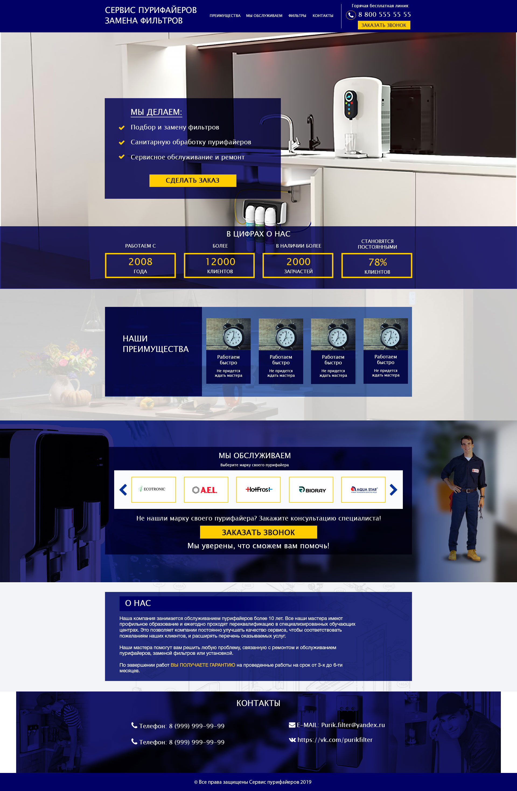

# Filter Profi

Архивный промо-лендинг сервиса по обслуживанию пурифайеров и замене фильтров. Проект создавался как отдельное направление компании AquaBorn, но направление не получило дальнейшего развития, и рабочий сайт больше не существует.



## Моя роль

- разработка визуального макета в Adobe Photoshop;
- адаптивная верстка страницы;
- реализация навигации, модального окна и карусели брендов;
- подготовка лендинга к первоначальному запуску.

## Стек

- HTML5;
- CSS3 и Sass;
- JavaScript и jQuery;
- Bootstrap 4;
- Owl Carousel.

## Статус

Репозиторий опубликован как исторический снимок ранней коммерческой работы и часть портфолио. Контактные данные, предложения и цифры на странице относятся к моменту разработки и могут быть неактуальны. Форма обратного звонка работает только как демонстрация интерфейса и не отправляет данные.

## Локальный просмотр

Проект не требует сборки. Запустите любой статический HTTP-сервер в корне репозитория, например:

```bash
python -m http.server 8080
```

Затем откройте `http://localhost:8080`.

## Права на материалы

Код опубликован для демонстрации и изучения. Товарные знаки, логотипы и изображения третьих лиц принадлежат их правообладателям.
